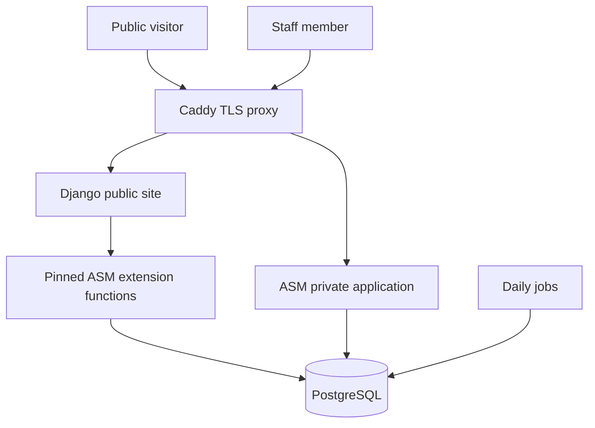

# Architecture

## Components and ownership

ASM owns animals, people, medical histories, treatment plans and administrations, movements, locations, documents, tasks, donations, staff permissions and audit records. Django owns only session, rate-window and submission-receipt metadata. Both schemas live in one PostgreSQL database so backups include the canonical records and receipt reconciliation state. Native media is stored in database DBFS. SQLite is a local development/testing convenience.

The source pin is `platform/upstream.json`. `fetch-core.py` verifies the Git revision, applies checked local patches and generates native schema JS from a disposable schema. The image retains corresponding source and notices. Integration imports pinned Python functions: this is an internal extension boundary, not a stable vendor API. An upgrade requires patch review, schema migration, regression tests and restore validation.

## Trust boundaries

Only Caddy publishes ports. It overwrites the client-address header; app trust is enabled only behind this proxy. Public requests never proxy arbitrary ASM methods. Catalogue, individual profile and photo requests all re-evaluate eligibility and project approved fields. Publication requires a preferred, publishable media item with explicit website copy; internal comments are never fallback text.

Public forms validate, require CSRF and session-bound submission tokens, apply a honeypot and a shared HMAC-address rate window, and insert native incoming form records. A unique receipt prevents repeat submissions. Ambiguous core write failures are marked for staff reconciliation rather than retried. This deliberately favours investigating an uncertain enquiry over duplicating a person/application.

## Concurrency and failure semantics

Cooperating mutation paths take a PostgreSQL advisory writer lock (local SQLite file lock). Native staff runs one Gunicorn worker with threads because native sessions are held in process memory. Scaling staff to multiple workers requires a reviewed shared-session design. Public can run multiple workers.

The native core performs some operations using multiple statements/connections. The writer lock serialises cooperating writers but does not make every operation transactional. All placement, bulk, import, capacity and interrupted-operation paths still need organisation-specific validation. Direct database tools and external import services can bypass application safeguards; restrict them operationally.

## Deliberate constraints

Generic native service/web-install endpoints are blocked. Unsafe remember-me storage is disabled. Forced TOTP enrolment is corrected for new accounts. Normal uploads are bounded, images re-encoded and PDFs gated on a scanner. Alternate import/attachment routes require further review. Logs suppress native record contents, reducing diagnostic detail in exchange for privacy.

The reviewed daily task list updates statuses, ages, figures and matching reports. It deliberately excludes automatic record/audit deletion, anonymisation, hold/reservation expiry, remote downloads and publishers. Notification tasks require NOTIFICATIONS_ENABLED=true and configured SMTP.

Jobs attempt once daily after 04:00 Europe/London. An attempt marker is written before execution; failure requires reconciliation. This avoids blind re-execution of partly completed native work. Real email delivery and interruption recovery remain release gates.

The reviewed clinical completion handlers use a copied native database object and a deferred-commit connection adapter. All statements in that operation share one real transaction; statement failures mark it failed even if caught upstream. PostgreSQL locks selected clinical/stock rows; SQLite begins an immediate transaction. Session database objects are never mutated. This bounded adapter does not make unrelated native handlers transactional. Correction snapshots bind the canonical row and its audit-row count with an HMAC; audit deletion/pruning remains disabled in normal jobs.
