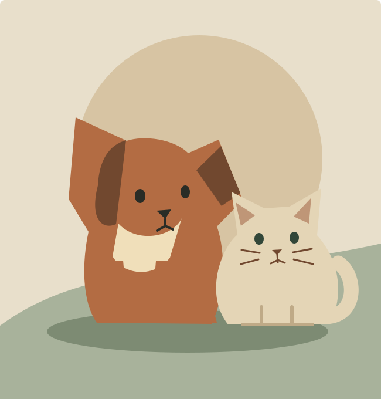
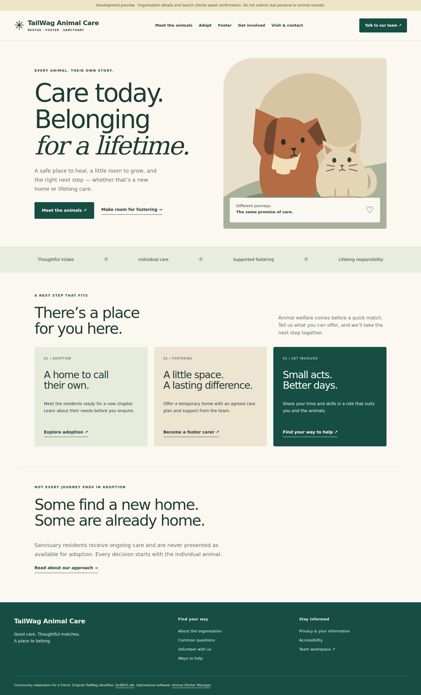
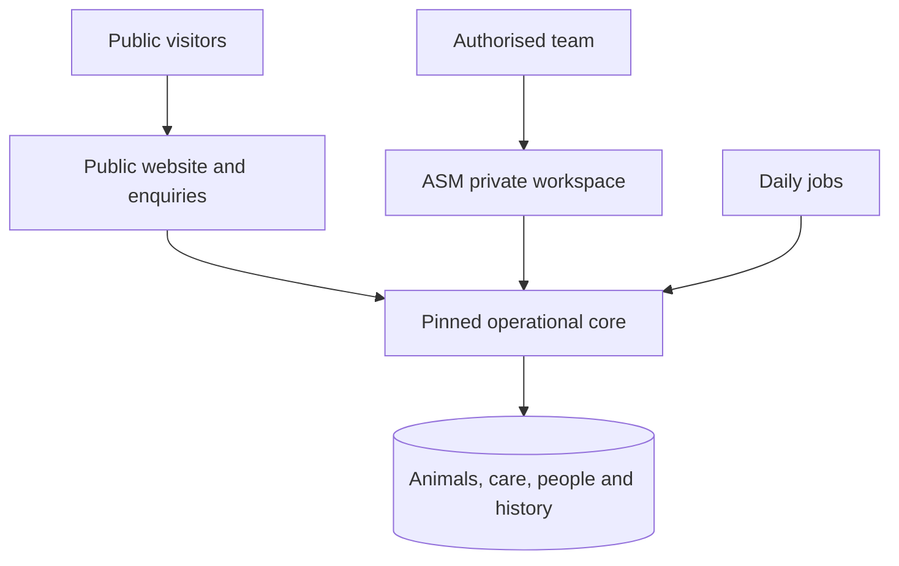

<div align="center">



# TailWag Animal Care

**Care today. Belonging for a lifetime.**

An operational platform in development for rescue, foster and sanctuary teams.

[](https://github.com/billyke2000s/Tailwag/actions/workflows/platform.yml)
[](STATUS.md)
[](platform/upstream.json)
[](platform/LICENSE)

[Evaluation release](https://github.com/billyke2000s/Tailwag/releases/tag/care-v0.1.0-alpha.4) · [Quick start](#run-locally) · [Architecture](ARCHITECTURE.md) · [Staff guide](docs/operations/STAFF.md) · [Deployment](DEPLOYMENT.md) · [Verification](docs/VERIFICATION.md)

</div>

> **Evaluation candidate.** Real backend records and connected public enquiries are implemented. This is not yet approved for live animal welfare operations. [Launch gates](docs/LAUNCH-READINESS.md) include complete access/lifecycle checks, organisation policies, hosting and external services.

**Original credit:** TailWag's original idea and files are by [fpr8653-afk](https://github.com/fpr8653-afk/tailwag). This repository adapts and improves that work **for a friend**; it does not claim to have invented or authored the original project. Operational records and private workflows are powered by [Animal Shelter Manager](https://github.com/sheltermanager/asm3). [Credits and licence boundaries →](THIRD-PARTY.md)

## A shared record, a considered next step

The platform connects an animal's identity, care, people, placements and history. A calm public website helps people understand adoption, fostering and sanctuary care. Public forms feed the actual private team inbox for assessment.



*Screenshots use explicitly synthetic development data. They do not show a real organisation or live care records.*

| Area | Available implementation | Boundary |
|---|---|---|
| Public website | Home/about, listings, profiles, adoption, fostering, volunteering, visiting, FAQ and policy pages | Approved fields only; preview identity/policies need configuration |
| Connected enquiries | Adoption, foster, volunteer and contact forms; validation, CSRF, abuse controls and receipts | Manual native inbox review; no automatic placement or email claim |
| Animal care | Pinned ASM care records; reviewed transactional completion, stock protection and attributed correction tasks | Veterinary SOPs and complete user acceptance still required |
| Placements | Native movement history; assessed households, dated overlap/peak foster-capacity guards and sanctuary checks | Selected paths tested; alternate/bulk/import and interruption gates remain |
| Documents | Restricted PDF export and isolated print previews | Reviewed editor/template/media routes; signatures and other routes need separate acceptance |
| Team operations | Native tasks, rota/training, stock, finance, search and reports | Least-privilege role templates require full boundary verification |
| Server preparation | PostgreSQL, migrations, container, TLS proxy, jobs, health, backup/restore helpers | No live host, provider delivery or operational recovery guarantee |

<details>
<summary><strong>Explore the screens and verification</strong></summary>

[Phone](docs/assets/platform/public-phone.png) · [Tablet](docs/assets/platform/public-tablet.png) · [Private desktop](docs/assets/platform/staff-desktop.png) · [Private phone](docs/assets/platform/staff-phone.png) · [Document editor](docs/assets/platform/document-editor.png)

The browser script checks representative routes, an actual incoming enquiry, keyboard skip navigation, staff sign-in/TOTP and three screen sizes. Read the dated [verification record](docs/VERIFICATION.md) for exact results and limitations; a screenshot is not proof that every workflow is ready.

</details>

## Run locally

Python 3.12, Git and native dependencies are required; see [development setup](DEVELOPMENT.md).

```sh
git clone https://github.com/billyke2000s/Tailwag.git
cd Tailwag
python3 -m venv .venv
.venv/bin/pip install -r platform/requirements.txt
.venv/bin/python platform/scripts/fetch-core.py
.venv/bin/python platform/scripts/dev.py --prepare
.venv/bin/python platform/scripts/dev.py --seed
.venv/bin/python platform/scripts/dev.py
```

Public website: **http://127.0.0.1:8000**. Team workspace: **http://localhost:5000**. The generated administrator password is stored privately in ignored `platform/runtime/dev-secrets.json`; enrol TOTP on first use. Seed data is optional and refuses a populated animal database. Never use real records in this development setup.

## One operational foundation



[Django](https://www.djangoproject.com/) provides the narrow public boundary; ASM remains the canonical operational store. This avoids disconnected contact, care and placement systems. [Reuse comparison](docs/REUSE.md) · [Inherited feature inventory](docs/FEATURE-INVENTORY.md) · [Technical design](ARCHITECTURE.md).

## Access follows responsibility

| User | Intended access |
|---|---|
| Visitor | Approved animal profiles and enquiry forms |
| Care / veterinary team | Relevant care records, observations, tasks and authorised treatment work |
| Placement team | Household review, intake and approved movement workflows |
| Volunteer / finance | Relevant assigned duties and limited operational records |
| Administrator | Reviewed configuration, accounts, recovery and audit |
| Foster carer | Gated until assigned-animal object-level access is verified |

Role templates are unassigned starting points. The complete server-side permission matrix remains a launch gate. See [specification](SPECIFICATION.md) and [security](SECURITY.md).

## Documentation that maps to the work

| Start here | Operate and maintain | Evidence and provenance |
|---|---|---|
| [Goals and scope](PROJECT.md) | [Development](DEVELOPMENT.md) | [Research and applicability](docs/RESEARCH.md) |
| [Behaviour and acceptance](SPECIFICATION.md) | [Testing](TESTING.md) / [document exports](docs/DOCUMENTS.md) | [Verification results](docs/VERIFICATION.md) |
| [Architecture](ARCHITECTURE.md) | [Deployment and rollback](DEPLOYMENT.md) | [Launch gates](docs/LAUNCH-READINESS.md) |
| [Current progress](STATUS.md) | [Staff guide](docs/operations/STAFF.md) | [Decisions](DECISIONS.md) |
| [Contributing](CONTRIBUTING.md) | [Administration](docs/operations/ADMINISTRATION.md) | [Credits](CREDITS.md) / [upstream](UPSTREAM.md) |
| [Agent instructions](AGENTS.md) | [Recovery](docs/operations/RECOVERY.md) / [acceptance rehearsal](docs/operations/ACCEPTANCE.md) | [History](CHANGELOG.md) / [licences](THIRD-PARTY.md) |

<details>
<summary><strong>Original React / PWA / Android demonstration</strong></summary>

The original dog/cat matching prototype remains at the repository root. Intentional sample content and offline generators are preserved. Its [v1.2.1 APK release](https://github.com/billyke2000s/Tailwag/releases/tag/v1.2.1) is independent of this operational platform and is not a live shelter client. [Prototype instructions →](docs/prototype/README.md)

</details>

## Before real-world use

Confirmed scope is England, dogs/cats and mixed rescue/foster/sanctuary operations. The actual council, legal entity, premises, capacities, clinical SOPs and hosting remain unconfirmed. Software supports welfare and accountability; it does not replace professional judgement, inspections or organisational duties. External email, donation providers, scanning and publishing are not operational until configured and verified.

Please report reproducible defects with synthetic examples through [issues](https://github.com/billyke2000s/Tailwag/issues). Private security reports follow [SECURITY.md](SECURITY.md).
