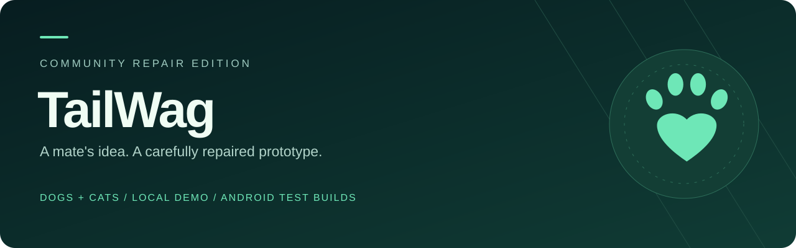
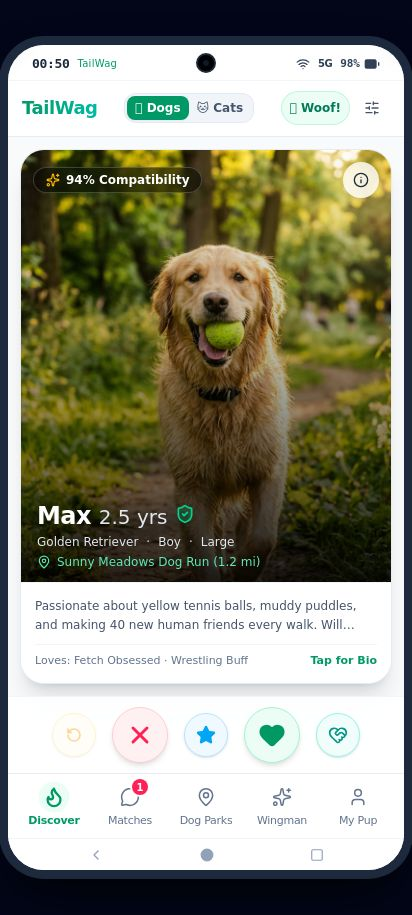
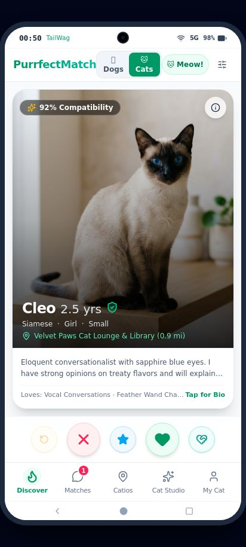
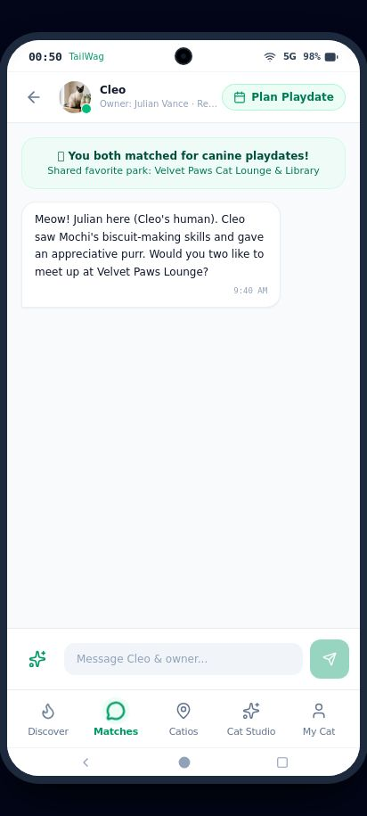

<div align="center">
  

  <h1>TailWag · Community repair edition</h1>
  <p>A dog and cat playdate prototype, repaired and packaged for Android.</p>

  <a href="https://github.com/billyke2000s/Tailwag/actions/workflows/build.yml"></a>
  <a href="https://github.com/billyke2000s/Tailwag/releases"></a>
  <a href="https://github.com/fpr8653-afk/tailwag"></a>
  <a href="TESTING.md"></a>
  <a href="DEVELOPMENT.md"></a>

  <p><a href="https://github.com/billyke2000s/Tailwag/releases"><strong>Download a test APK</strong></a> · <a href="#quick-start">Run locally</a> · <a href="#documentation">Documentation</a> · <a href="https://github.com/billyke2000s/Tailwag/issues/new/choose">Report a bug</a></p>
</div>

> [!IMPORTANT]
> **Credit belongs to the original creator.** The idea and original project files were created in [fpr8653-afk/tailwag](https://github.com/fpr8653-afk/tailwag). I did not create the original app or come up with its idea. I’m helping a mate by fixing issues, improving the documentation and making Android builds easier to test. This repository contains those repairs and packaging work. See [CREDITS.md](CREDITS.md) and [UPSTREAM.md](UPSTREAM.md).

## A prototype you can explore

TailWag pairs playful dog and cat profiles with swipe discovery, mock conversations, park or catio check-ins, and a playdate scheduler. The original design, sample content and simulations are preserved. This edition focuses on making those existing flows dependable.

| Explore | What you can try |
| :--- | :--- |
| **Dogs & cats** | Switch between the original canine profiles and the upstream feline additions. |
| **Discover** | Filter by distance, size, energy, purpose and health fields; swipe and rewind. |
| **Conversations** | Send test messages and receive simulated replies without losing the thread when switching tabs. |
| **Meetups** | Pick a park or catio, choose a playmate, and open the scheduler with that context preserved. |
| **Personalise** | Edit pet profiles and save sound and alert preferences locally. |
| **Android** | Install a test APK with the web app and its eight local photos bundled inside. |

> [!NOTE]
> Profiles, ratings, matches, owner replies, activity counts and playdates are intentional demo content. Data is saved on your device. Cloud messaging, real account verification and adoption/fostering workflows are outside the current prototype. The Wingman uses local text templates and needs no API key.

## Preview

<table>
<tr><th>Dog discovery</th><th>Cat discovery</th><th>Conversations</th></tr>
<tr>
<td></td>
<td></td>
<td></td>
</tr>
</table>

Screenshots show the running production web build with sample data. [Browse the source components](src/components) · [Read the behaviour specification](SPECIFICATION.md)

## What this edition fixes

| Area | Repair |
| :--- | :--- |
| Production images | Bundle the original dog and cat photos correctly; use a local fallback for failed images. |
| Data continuity | Preserve profiles, messages, discovery history, check-ins and preferences locally. |
| Discovery | Use stable IDs, apply every exposed filter, guard rapid swipes, and restore rewind at deck end. |
| Meetups | Carry the chosen park and recipient into the scheduler. |
| Status & settings | Render supplied health values accurately, share sound preferences and clear read messages. |
| Navigation | Give modals focus handling and connect physical Android Back to app navigation. |
| Android builds | Include the Gradle wrapper, launcher resources, bundled assets and a canonical project ZIP. |
| Maintenance | Add regression tests, build automation, release packaging and honest status reporting. |

<details>
<summary><strong>Which upstream additions are included?</strong></summary>

The baseline is upstream commit [`f993919`](https://github.com/fpr8653-afk/tailwag/commit/f993919378a8bfa12456e9de5808901fd47ff36e), including the dog/cat switcher, cat profiles and images, catios, feline UI labels, and meow/purr synthesis. The offline cat text templates are retained. Browser-side provider credentials were removed as part of the repair.

See [UPSTREAM.md](UPSTREAM.md) for the exact source revision and the procedure for incorporating later changes.

</details>

## Download and install

1. Open [Releases](https://github.com/billyke2000s/Tailwag/releases).
2. Download the asset ending in **`-debug.apk`** to test on Android 7.0 or later.
3. Open it on the device and allow installation from your chosen browser/file manager when Android asks.
4. Keep any test data you need before uninstalling; local data is removed when app data is cleared.

<details>
<summary><strong>Which download do I need?</strong></summary>

| Asset | Use |
| :--- | :--- |
| `TailWag-<version>-debug.apk` | Install and test the app on Android. |
| `TailWag-Android-Project.zip` | Open/build the Android project with the frontend already bundled. |
| `SHA256SUMS.txt` | Check that downloaded assets match the published checksums. |
| GitHub source archives | Develop the full React + Android project. Run the web build before Gradle. |

These are development-signed preview builds. Signing keys can differ between builds, so Android may require uninstalling an older test build. This is not a Play Store release. No physical-device validation is claimed unless recorded in the release notes.

</details>

## Quick start

Requires **Node 22.12+** and npm.

```bash
git clone https://github.com/billyke2000s/Tailwag.git
cd Tailwag
npm ci
npm run dev
```

Open `http://localhost:3000`. No provider API key or backend setup is required.

<details>
<summary><strong>Build and serve the production web app</strong></summary>

```bash
npm run build
npm run preview
```

The build prepares `dist`, copies web assets into the Android project, and exports the same Android source as `dist/TailWag-Android-Project.zip`. Test the production output when checking asset paths and offline caching.

</details>

<details>
<summary><strong>Build the Android APK</strong></summary>

Install **Java 17**, **Android SDK platform 34** and **build tools 34.0.0**. Configure `ANDROID_HOME` or ignored `android/local.properties`.

```bash
npm ci
npm run build:apk
```

Output: `android/app/build/outputs/apk/debug/app-debug.apk`.

On Windows, run `npm run build`, then `cd android` and `gradlew.bat assembleDebug`. The exported Android ZIP already contains the web assets and can be built directly with its wrapper.

</details>

<details>
<summary><strong>Run verification</strong></summary>

```bash
npm run lint
npm test
npm run build
npx playwright install chromium
npm run test:e2e
```

The repair baseline passed six Node tests and eight production-browser checks, plus Android build, signature and archive checks. Current CI and release results are shown by the live build badge and workflow logs. Physical-device checks remain separate; see [TESTING.md](TESTING.md).

</details>

## Documentation

| Start here | Engineering | Project record |
| :--- | :--- | :--- |
| [Overview & goals](PROJECT.md) | [Architecture](ARCHITECTURE.md) | [Current status](STATUS.md) |
| [Behaviour](SPECIFICATION.md) | [Development setup](DEVELOPMENT.md) | [Decisions](DECISIONS.md) |
| [Contributing](CONTRIBUTING.md) | [Testing](TESTING.md) | [Changelog](CHANGELOG.md) |
| [Credits](CREDITS.md) | [Security](SECURITY.md) | [Upstream tracking](UPSTREAM.md) |
| [Support & troubleshooting](SUPPORT.md) | [AI contribution rules](AGENTS.md) | [Release process](docs/RELEASING.md) |

## Built with

React 19 · TypeScript · Vite · Tailwind CSS · Motion · Android WebViewAssetLoader · Gradle · Playwright

## Contribute or report a problem

Use the [bug report](https://github.com/billyke2000s/Tailwag/issues/new?template=bug_report.yml) or [feature request](https://github.com/billyke2000s/Tailwag/issues/new?template=feature_request.yml) forms. Include the version, device/browser, reproduction steps and expected result. Keep fixes focused and preserve intentional sample data. Read [CONTRIBUTING.md](CONTRIBUTING.md) before sending a pull request.

Original project credit remains with [fpr8653-afk](https://github.com/fpr8653-afk). This repository is maintained by [billyke2000s](https://github.com/billyke2000s) as repair work for a mate. Existing copyright notices remain intact; no blanket relicensing of upstream files is claimed.
