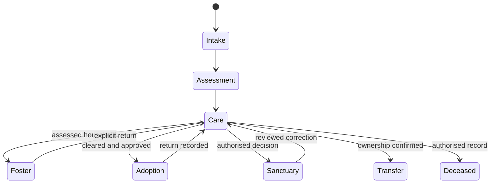

# Product specification

This describes target workflows and the implemented boundary. An acceptance criterion is not marked passed merely because the native system contains a related feature. Evidence is in docs/VERIFICATION.md; open gates are in docs/LAUNCH-READINESS.md. Research applicability is in docs/RESEARCH.md.

## Roles and information

| Role | Intended responsibilities | Restrictions |
|---|---|---|
| Public | Read approved profiles; send enquiries | No operational records or attachments |
| Care | Daily care, observations, assigned tasks | No administration or unnecessary finance/person exports |
| Veterinary | Authorised medical instructions and administration | No inferred prescribing; access needs organisational approval |
| Placement | Intake, assessment, approved moves and follow-up | Capacity, compatibility and ownership review required |
| Volunteer | Assigned tasks and approved training duties | No broad person/medical access |
| Finance | Donations/stock and relevant reporting | No clinical decisions |
| Administrator | Configuration, account and recovery operations | Individual account, TOTP, reviewed privileged access |
| Foster carer | Intended access only to assigned animals/tasks | Not enabled until object-level authorisation is demonstrated |

Native role templates exist but are deliberately unassigned. The table is the intended policy; full route-level evidence is outstanding.

## Canonical data

Animal identity links microchip/registration, species, birth estimate, intake/source, ownership evidence, current status/location, medical/tests/vaccinations/treatments, behaviour/observations, feeding/enrichment/cleaning diary, movements, media, documents and audit. People link assessed households, foster capacity, applications and agreements. Native stock, donations, volunteer rota/training, appointments and reports are reused. Django contains only sessions, receipt state and rate-window metadata.

## Lifecycle rules

This is a domain specification, not a claim that one native enum enforces every arrow. Holds, quarantine, medical readiness and availability are independent attributes. Never delete a movement to conceal a return. A permanent sanctuary resident is not publicly adoptable. Corrections retain attribution and reason. Capacity covers premises, rooms/enclosures and foster households; species and compatibility checks must be configured and tested before use.

## Workflow acceptance criteria

| ID | Workflow | Acceptance criteria / current evidence |
|---|---|---|
| PUB-1 | Catalogue/profile/photo | Recheck eligibility on every request; allowlist fields; no internal comments/foster addresses; unavailable, reserved, quarantined, deceased and sanctuary animals excluded. Integration tests pass. |
| FORM-1 | Enquiry | Validate fields/CSRF/token; spam/rate control; insert actual native inbox record; confirmation reference; repeated token does not duplicate; uncertain write requires review. Integration tests pass. |
| AUTH-1 | Staff | Individual account, forced TOTP, server permissions, recovery audit, origin rejection, session expiry. Some implementation verified; complete role/object matrix open. |
| INT-1 | Intake | Identity/source/ownership documents; duplicate search; species care needs; quarantine and placement review; history retained. Native workflow adopted; end-to-end acceptance open. |
| MED-1 | Care | Authorised instructions, actual administration and missed-dose reasons, vaccine/test history, handover and urgent escalation; no generated doses. Native selected tests pass; clinical SOP/end-to-end review open. |
| MOVE-1 | Foster/adoption | Assessed household, approved capacity, no conflicting active placement, explicit return, unavailable/sanctuary adoption blocked, history retained. Selected wrappers tested; bulk/import/concurrent interruption paths open. |
| OPS-1 | Tasks/stock/people | Assigned responsibilities, scheduling/rota, training, inventory and reporting use native records. Organisation configuration and user acceptance open. |
| DATA-1 | Records/rights | Private documents and exports, audit, corrections, archive, retention/legal hold, approved deletion and recovery drill. Native tools adopted; actual policy and full drill open. |
| RUN-1 | Server | Fresh PG install/migrations, TLS, secret management, jobs/monitoring, backup/restore and rollback. Configuration prepared; evidence tracked separately. |

## Public pages and states

Home/about, animals/detail, adoption, fostering, volunteering/help, visiting/contact, FAQ, privacy and accessibility are implemented. Donations are an optional configured external link; no placeholder payment form. Enquiries connect to native incoming forms for manual assessment. Empty results differ from a backend outage. Forms retain entered values on validation errors and show a unique receipt after confirmed submission. Preview banners remain until PUBLIC_LAUNCH is explicitly configured.

## Launch requirements

Real organisation contact/policies, council applicability, capacities, clinical SOPs, approved access matrix, hosting and backup ownership must be recorded. Operational success requires evidence across all acceptance criteria, including failure/concurrent paths and representative assistive-technology use. Software does not replace welfare professionals, inspections or organisational obligations.
